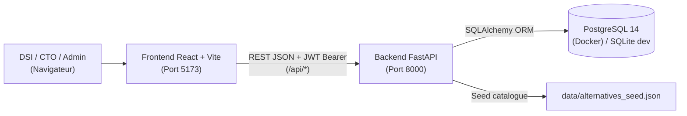
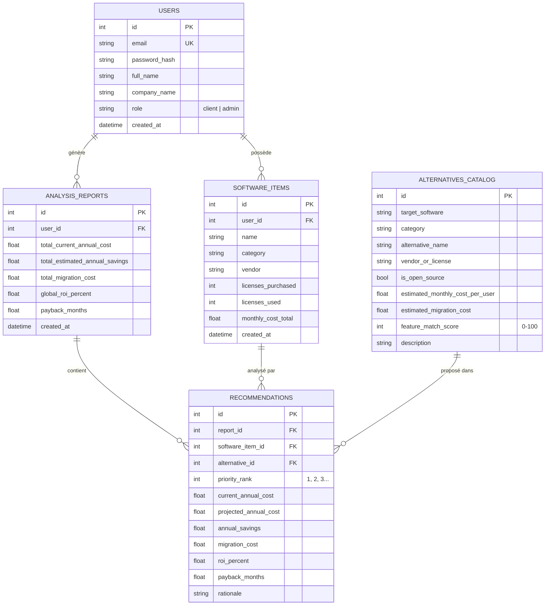

# Architecture Technique & Spécifications V1 — OptiStack

Ce document formalise l'architecture technique, le modèle de données, le contrat d'API, le format d'import CSV et les formules de calcul de ROI pour la **V1 (MVP)** d'OptiStack, en cohérence avec [use_cases.puml](use_cases.puml), [class_diagram.puml](class_diagram.puml), [sequence_analysis.puml](sequence_analysis.puml), [.env.example](../.env.example) et [docker-compose.yml](../docker-compose.yml).

---

## 1. Vue d'ensemble de l'architecture

OptiStack suit une architecture web découplée en 3 couches :



### Choix techniques V1
- **Backend** : Python 3.11+, **FastAPI**, Pydantic v2, SQLAlchemy 2, authentification JWT (`HS256`, durée définie par `ACCESS_TOKEN_EXPIRE_MINUTES`).
- **Base de données** : **PostgreSQL 14** via [docker-compose.yml](../docker-compose.yml) (avec compatibilité SQLite locale via `DATABASE_URL` pour faciliter les tests unitaires et le développement sans Docker).
- **Frontend** : **React + Vite**, consommation de l'API via `VITE_API_URL` (`http://localhost:8000/api`).
- **Moteur de recommandation V1** : moteur déterministe basé sur un catalogue de référence local ([alternatives_seed.json](../data/alternatives_seed.json)) et des règles de scoring/ROI, sans dépendance bloquante à une clé API externe.

---

## 2. Arborescence cible du code source

```text
├── data/
│   ├── alternatives_seed.json   # Catalogue initial d'alternatives open-source / économiques
│   └── sample_inventory.csv     # Jeu d'essai CSV PME (import < 5 min)
├── docs/
│   ├── architecture.md          # Ce document
│   ├── automatisation.md
│   ├── class_diagram.puml       # Diagramme de classes UML
│   ├── gantt_v1.md
│   ├── sequence_analysis.puml   # Diagramme de séquence UML
│   └── use_cases.puml
└── src/
    ├── backend/
    │   ├── app/
    │   │   ├── main.py          # Point d'entrée FastAPI + CORS + routes
    │   │   ├── config.py        # Chargement des variables .env
    │   │   ├── database.py      # Engine SQLAlchemy + SessionLocal
    │   │   ├── models.py        # Modèles ORM
    │   │   ├── schemas.py       # Schémas Pydantic (requêtes / réponses)
    │   │   ├── auth.py          # Hash mot de passe + tokens JWT
    │   │   ├── routers/         # auth, inventory, alternatives, analysis, reports
    │   │   └── services/        # csv_parser, roi_engine, report_exporter
    │   ├── tests/               # Tests pytest (> 70% coverage cible)
    │   └── requirements.txt
    └── frontend/
        ├── src/
        │   ├── api/             # Client HTTP + gestion JWT
        │   ├── components/      # Upload CSV, tableaux KPI, graphiques
        │   └── pages/           # Login, Dashboard, Inventory, Reports
        └── package.json
```

---

## 3. Modèle de données (ER)



### Contraintes métier clés
- `licenses_purchased >= 1` et `0 <= licenses_used <= licenses_purchased`.
- `monthly_cost_total >= 0`.
- `role` vaut `"client"` par défaut (accès admin réservé à l'édition du catalogue d'alternatives).
- Chaque rapport enregistre un instantané chiffré (`recommendations`) pour garantir la reproductibilité des exports CSV/PDF.

---

## 4. Contrat d'API REST (`/api`)

Toutes les routes (hors `/api/health`, `/api/auth/register`, `/api/auth/login`) exigent l'en-tête `Authorization: Bearer <token>`.

| Domaine | Méthode & Route | Cas d'utilisation | Rôle / Description |
| --- | --- | --- | --- |
| **Système** | `GET /api/health` | — | Vérifie l'état de l'API et de la base (`{"status": "ok"}`). |
| **Auth** | `POST /api/auth/register` | `UC_Account` | Crée un compte utilisateur (`email`, `password`, `full_name`, `company_name`). |
| **Auth** | `POST /api/auth/login` | `UC_Login` | Retourne `access_token` (JWT) + `token_type: "bearer"`. |
| **Auth** | `GET /api/auth/me` | `UC_Account` | Retourne le profil de l'utilisateur connecté. |
| **Inventaire** | `GET /api/inventory` | `UC_ViewCosts` | Liste les logiciels du client + agrégats (coût annuel total, taux d'usage moyen). |
| **Inventaire** | `POST /api/inventory` | `UC_ManualEntry` | Ajoute un logiciel manuellement (`201 Created`). |
| **Inventaire** | `PUT /api/inventory/{id}` | `UC_ManualEntry` | Met à jour un logiciel existant de l'utilisateur. |
| **Inventaire** | `DELETE /api/inventory/{id}` | `UC_ManualEntry` | Supprime un logiciel de l'inventaire. |
| **Inventaire** | `POST /api/inventory/import-csv` | `UC_ImportCSV` | Importe un fichier CSV (`multipart/form-data`), valide les lignes et retourne le bilan (`imported_count`, `errors`). |
| **Catalogue** | `GET /api/alternatives` | `UC_Compare` | Liste les alternatives disponibles (filtrable par `category` ou `target_software`). |
| **Catalogue** | `POST /api/alternatives` | `UC_Analyze` (Admin) | Ajoute une alternative au catalogue (rôle `admin` requis). |
| **Analyse** | `POST /api/analysis/run` | `UC_Analyze`, `UC_ROI` | Analyse l'inventaire courant, sélectionne au moins les **3 meilleures recommandations** et crée un rapport. |
| **Rapports** | `GET /api/analysis/reports` | `UC_Report` | Historique des rapports générés pour l'utilisateur. |
| **Rapports** | `GET /api/analysis/reports/{id}` | `UC_Report`, `UC_Compare` | Détail complet d'un rapport et de ses recommandations classées. |
| **Export** | `GET /api/reports/{id}/export?format=csv\|pdf` | `UC_Export` | Télécharge le rapport au format CSV (`text/csv`) ou PDF (`application/pdf`). |

---

## 5. Spécification du format CSV d'import

Le fichier exemple prêt à l'emploi est disponible dans [data/sample_inventory.csv](../data/sample_inventory.csv).

- **Encodage** : UTF-8 (avec ou sans BOM).
- **Séparateur** : virgule `,` (détection tolérante du point-virgule `;` pour compatibilité Excel FR).
- **Colonnes obligatoires** :

| Colonne | Type | Exemple | Règle de validation |
| --- | --- | --- | --- |
| `name` | `string` | `Power BI Pro` | Non vide, max 120 caractères |
| `category` | `string` | `BI & Analytics` | Non vide (ex. `BI & Analytics`, `Communication`, `Gestion de projet`, `Bureautique`, `Design`, `CRM`, `Visioconférence`, `Documentation`) |
| `vendor` | `string` | `Microsoft` | Optionnel (vide autorisé) |
| `licenses_purchased` | `int` | `30` | Entier `>= 1` |
| `licenses_used` | `int` | `14` | Entier `>= 0` et `<= licenses_purchased` |
| `monthly_cost_total` | `float` | `300.00` | Nombre `>= 0` (coût mensuel total en EUR pour ce logiciel) |

En cas de ligne invalide, le endpoint `POST /api/inventory/import-csv` retourne le numéro de ligne et la cause précise sans faire planter l'API.

---

## 6. Formules de calcul de coûts et de ROI

Pour chaque logiciel $i$ de l'inventaire :

1. **Coût annuel actuel** :
   $$C_{\text{actuel}} = \text{monthly\_cost\_total} \times 12$$

2. **Taux d'utilisation des licences** :
   $$U = \frac{\text{licenses\_used}}{\text{licenses\_purchased}} \times 100$$
   - Un logiciel avec $U < 70\%$ est signalé comme **sous-utilisé** (gaspillage de licences payées mais inactives).

3. **Coût annuel projeté avec l'alternative** (dimensionné sur les licences réellement utilisées) :
   $$C_{\text{projeté}} = \text{estimated\_monthly\_cost\_per\_user} \times \text{licenses\_used} \times 12$$
   *(Pour une alternative open-source auto-hébergée ou gratuite sur le plan communautaire, `estimated_monthly_cost_per_user` peut valoir `0` ou représenter le coût estimé de support/hébergement par utilisateur.)*

4. **Économie annuelle brute** :
   $$E_{\text{annuelle}} = C_{\text{actuel}} - C_{\text{projeté}}$$

5. **ROI sur 12 mois (%)** (avec coût ponctuel de transition $M = \text{estimated\_migration\_cost}$) :
   - Si $M > 0$ :
     $$\text{ROI}_{1\text{an}} = \frac{E_{\text{annuelle}} - M}{M} \times 100$$
   - Si $M = 0$ : le coût de migration est nul (ROI non borné / gain immédiat, représenté par `null` dans l'API et affiché « Gain immédiat » côté interface).

6. **Délai de retour sur investissement (Payback en mois)** :
   - Si $E_{\text{annuelle}} > 0$ :
     $$\text{Payback}_{\text{mois}} = \frac{M}{E_{\text{annuelle}} / 12}$$

### Classement des recommandations (Top 3 V1)
1. Pour chaque logiciel de l'inventaire, le moteur recherche d'abord une correspondance exacte sur `target_software` (insensible à la casse), puis à défaut sur `category` dans `alternatives_catalog`.
2. Seules les alternatives offrant une économie annuelle positive ($E_{\text{annuelle}} > 0$) sont retenues.
3. Les recommandations sont triées par **gain net sur 1 an décroissant** ($E_{\text{annuelle}} - M$), puis par `feature_match_score` décroissant, et numérotées (`priority_rank = 1, 2, 3, ...`) afin de garantir au minimum les **3 recommandations prioritaires** attendues pour la V1.
